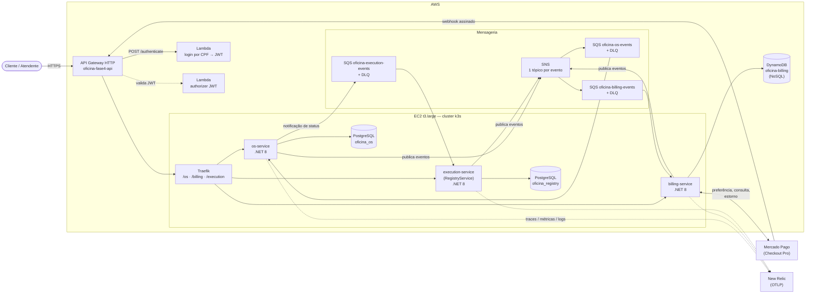
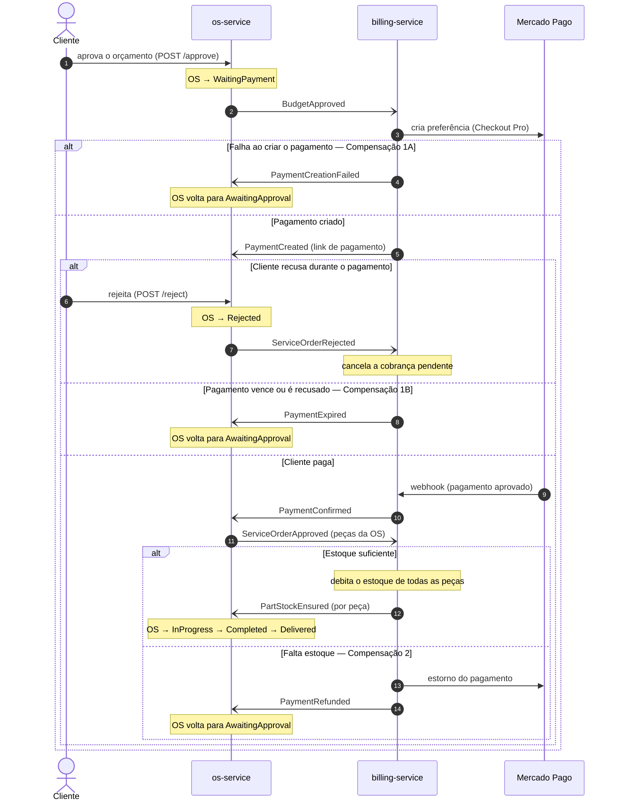

# Arquitetura — Tech Challenge Fase 4 (Oficina Mecânica)

Documento único com a visão geral da solução: diagrama da arquitetura, estratégia de Saga e compensações,
divisão dos microsserviços, tecnologias e onde comprovar cada requisito do enunciado.

| Repositório | Papel |
| --- | --- |
| [os-service](https://github.com/jaimorais2007/os-service) | Ordens de serviço: abertura, orçamento, aprovação, status e histórico |
| [billing-service](https://github.com/jaimorais2007/billing-service) | Catálogo de serviços e peças, estoque, pagamento e estorno no Mercado Pago |
| [execution-service](https://github.com/jaimorais2007/execution-service) | Serviço de **cadastros (RegistryService)**: clientes e veículos, e e-mails de mudança de status da OS |
| [infra-terraform](https://github.com/jaimorais2007/infra-terraform) | Infraestrutura AWS (SNS, SQS, DynamoDB, IAM, API Gateway) e manifestos base do cluster |
| [ci-templates](https://github.com/jaimorais2007/ci-templates) | Pipeline reutilizável de CI/CD usada pelos 3 serviços |

---

## 1. Diagrama geral da arquitetura

**Fluxo de entrada.** Todas as chamadas passam pelo API Gateway. O cliente faz login em `POST /authenticate`
(Lambda da Fase 3, login por CPF) e recebe um JWT. As rotas `/api/*` são protegidas pelo authorizer JWT (Lambda).
As rotas de health check e o webhook do Mercado Pago (`POST /api/webhooks/mercadopago`) são públicas. O webhook
é validado pela assinatura `x-signature` dentro do billing-service.

**Roteamento.** O API Gateway encaminha por prefixo de rota para o cluster. O Traefik separa `/os`, `/billing` e
`/execution` e remove o prefixo (`StripPrefix`) antes de entregar ao serviço ([`k8s/ingress.yaml`](../k8s/ingress.yaml)).

**Banco por serviço.** Nenhum serviço acessa o banco de outro. A integração acontece somente por eventos (SNS/SQS)
ou pelas APIs expostas no Gateway.

---

## 2. Saga Pattern: coreografia

### Estratégia escolhida

Adotamos a **Saga coreografada**, sem orquestrador central. Cada serviço publica eventos de domínio no SNS
(um tópico por evento) e reage aos eventos que assina pela sua fila SQS.

Por que coreografia:

- **Desacoplamento.** O os-service não conhece o Mercado Pago nem a tabela de estoque. O billing-service não conhece
  as regras de status da OS. Cada um reage apenas a eventos.
- **Sem ponto único de falha.** Não há um orquestrador que guarde o estado global da transação. Se um serviço cair,
  as mensagens ficam na fila e são processadas quando ele voltar.
- **Fluxo linear e com poucos participantes.** A transação distribuída envolve basicamente dois serviços (OS e
  Billing) em uma sequência curta. Nesse cenário, a coreografia é simples de seguir e não exige um componente extra.

Para garantir consistência mesmo com falhas e reentregas, os dois participantes usam:

- **Outbox transacional.** O evento é gravado na mesma transação da mudança de estado (tabela `OutboxMessage` no
  PostgreSQL do os-service; item `OUTBOX` na transação `TransactWriteItems` do DynamoDB no billing-service). Um
  worker publica no SNS depois. Isso elimina o problema de *dual write* entre banco e broker.
- **Inbox idempotente.** Cada evento consumido é registrado pelo seu `EventId` (`ProcessedSagaEvent` no os-service,
  `EVENT#<eventId>` no billing-service). Uma reentrega do SQS (*at-least-once*) não gera efeito duplicado.
- **DLQ.** Cada fila tem uma fila de mensagens mortas: depois de 5 tentativas sem sucesso, a mensagem vai para a DLQ.
- **Rastreamento.** O `traceparent` (W3C) viaja como *message attribute* do SNS/SQS, o que permite acompanhar a
  Saga entre os serviços como trace distribuído no New Relic.

### Caminho feliz e compensações

| Situação | Evento | O que acontece |
| --- | --- | --- |
| Orçamento aprovado | `BudgetApproved` (os → billing) | Billing cria a cobrança no Mercado Pago e responde com `PaymentCreated` (link de pagamento) |
| **Compensação 1A**: falha ao criar o pagamento | `PaymentCreationFailed` (billing → os) | A OS volta de `WaitingPayment` para `AwaitingApproval` |
| **Compensação 1B**: pagamento vencido ou recusado | `PaymentExpired` (billing → os) | O checkout vence (validade padrão de 60 min, verificada a cada 5 min) ou é recusado no webhook; a OS volta para `AwaitingApproval` |
| **Recusa durante o pagamento** | `ServiceOrderRejected` (os → billing) | A OS vai para `Rejected` e o billing cancela a cobrança pendente |
| Pagamento confirmado | `PaymentConfirmed` (billing → os) | Sem peças, a OS vai para `InProgress`. Com peças, o os publica `ServiceOrderApproved` para reservar o estoque |
| Estoque garantido | `PartStockEnsured` (billing → os) | O estoque é debitado de forma atômica; com todas as peças garantidas, a OS vai para `InProgress` |
| **Compensação 2**: falta de estoque após o pagamento | `PaymentRefunded` (billing → os) | O billing não debita nada, estorna o pagamento no Mercado Pago e a OS volta para `AwaitingApproval` |

O contrato completo de eventos (quem publica e quem consome) está em [`variables.tf`](../variables.tf) (`var.events`)
e na tabela do [README](../README.md#contrato-de-eventos-saga-coreografada) deste repositório.

---

## 3. Divisão dos microsserviços

| Serviço | Responsabilidade | Banco | Justificativa |
| --- | --- | --- | --- |
| **os-service** | Abertura da OS, diagnóstico, orçamento, aprovação/rejeição, status e histórico; participante da Saga | PostgreSQL (`oficina_os`) | A OS é o agregado central, com máquina de estados e histórico de status. Os dados são relacionais (OS, peças, serviços, status) e exigem transação ACID para gravar o estado junto com o outbox |
| **billing-service** | Catálogo de serviços e peças, estoque, pagamento, expiração e estorno no Mercado Pago | DynamoDB (`oficina-billing`, NoSQL) | Acesso sempre por chave (peça, pagamento, OS). O DynamoDB oferece transação atômica em vários itens (`TransactWriteItems`), usada para debitar o estoque e gravar o outbox de uma vez. Isola a integração com o meio de pagamento em um único serviço |
| **execution-service** (RegistryService) | Cadastro de clientes e veículos; envio de e-mail ao cliente quando a OS muda de status | PostgreSQL (`oficina_registry`) | Cadastros têm relações fortes (cliente 1:N veículos) e regras de validação (CPF/CNPJ, placa antiga e Mercosul). Separar os cadastros tira essa responsabilidade do os-service e concentra as notificações em um só lugar |

**Observação para a avaliação:** o repositório `execution-service` contém o **serviço de cadastros (RegistryService)**.
A divisão foi revista pelo grupo durante a fase: o acompanhamento de execução (diagnóstico, reparo, finalização e
entrega) ficou no ciclo de vida da OS, dentro do os-service, e o terceiro serviço passou a concentrar os cadastros.

---

## 4. Tecnologias utilizadas

| Tema | Tecnologia | Onde |
| --- | --- | --- |
| Linguagem | C# / .NET 8 (ASP.NET Core), Clean Architecture | os, billing, execution |
| Banco SQL | PostgreSQL com EF Core (StatefulSet no k3s) | os-service, execution-service |
| Banco NoSQL | Amazon DynamoDB (tabela única `oficina-billing`) | billing-service |
| Mensageria | Amazon SNS (um tópico por evento) + Amazon SQS (uma fila por serviço, com DLQ) | infra-terraform |
| Saga | Coreografada, com outbox transacional e inbox idempotente | os-service, billing-service |
| Pagamento | Mercado Pago Checkout Pro (preferência, webhook com assinatura, consulta e estorno) | billing-service |
| Entrada e autenticação | Amazon API Gateway HTTP + Lambdas da Fase 3 (login por CPF que emite JWT, e authorizer JWT) | infra-terraform |
| E-mail | SMTP (MailKit) | execution-service |
| Containers | Docker; imagens publicadas no GitHub Container Registry (GHCR) | 3 serviços |
| Orquestração | Kubernetes k3s em EC2, com Traefik como ingress | infra-terraform/k8s |
| Infraestrutura como código | Terraform, com state remoto em S3 | infra-terraform |
| CI/CD | GitHub Actions com workflow reutilizável (build, testes, cobertura, SonarCloud, imagem e deploy no k3s) | ci-templates |
| Testes unitários | xUnit, Moq, coverlet | 3 serviços |
| BDD | Reqnroll (Gherkin) | os-service |
| Qualidade | SonarCloud com quality gate; a pipeline falha com cobertura abaixo de 80% | ci-templates, 3 serviços |
| Observabilidade | OpenTelemetry (traces, métricas e logs) exportado via OTLP para o New Relic | 3 serviços |

**Cobertura de testes no SonarCloud (quality gate aprovado nas duas medições):**

| Serviço | 07/11/2026 | 19/11/2026 (após a Saga) |
| --- | --- | --- |
| os-service | 98,6% | 87,8% |
| billing-service | 97,3% | 95,3% |
| execution-service | 91,8% | 93,1% |

Os selos no topo de cada README mostram o valor atual. A pipeline bloqueia qualquer PR que deixe a cobertura abaixo de 80%.

---

## 5. Onde comprovar cada requisito

| Requisito do enunciado | Onde comprovar |
| --- | --- |
| 3 microsserviços em repositórios próprios | [os-service](https://github.com/jaimorais2007/os-service), [billing-service](https://github.com/jaimorais2007/billing-service), [execution-service](https://github.com/jaimorais2007/execution-service) |
| Banco próprio por serviço | os: [`k8s/postgres-os.yaml`](../k8s/postgres-os.yaml) · execution: [`k8s/postgres-execution.yaml`](../k8s/postgres-execution.yaml) · billing: [`dynamodb.tf`](../dynamodb.tf) |
| Pelo menos um banco SQL e um NoSQL | PostgreSQL (os, execution) e DynamoDB (billing): seção 4 acima |
| Mensageria assíncrona | [`messaging.tf`](../messaging.tf) e [`variables.tf`](../variables.tf) (`var.events`) |
| API REST síncrona | API Gateway em [`apigateway.tf`](../apigateway.tf); Swagger em `src/*/Program.cs` de cada serviço |
| Saga com compensação | [os-service — `SagaEventProcessor.cs`](https://github.com/jaimorais2007/os-service/blob/main/src/OSService.Application/Saga/SagaEventProcessor.cs) · [billing-service — `ServiceOrderApprovedHandler.cs`](https://github.com/jaimorais2007/billing-service/blob/main/src/BillingService.Application/Catalog/ServiceOrderApprovedHandler.cs) · [README do os-service](https://github.com/jaimorais2007/os-service#saga-pattern-coreografado-aceite-de-or%C3%A7amento-pagamento-e-estoque) |
| Escolha da Saga documentada | Seção 2 deste documento |
| Integração com Mercado Pago | [billing-service — `MercadoPagoClient.cs`](https://github.com/jaimorais2007/billing-service/blob/main/src/BillingService.Infrastructure/MercadoPago/MercadoPagoClient.cs) e [`MercadoPagoWebhookController.cs`](https://github.com/jaimorais2007/billing-service/blob/main/src/BillingService.Api/Controllers/MercadoPagoWebhookController.cs) |
| Testes unitários nos 3 serviços | pasta `tests/` de cada repositório |
| BDD em pelo menos um fluxo | [`ServiceOrderLifecycle.feature`](https://github.com/jaimorais2007/os-service/blob/main/tests/OSService.Tests/BDD/Features/ServiceOrderLifecycle.feature) (inclui caminho feliz da Saga e Compensações 1 e 2) |
| Cobertura ≥ 80% | SonarCloud: [os-service](https://sonarcloud.io/summary/overall?id=jaimorais2007_os-service) · [billing-service](https://sonarcloud.io/summary/overall?id=jaimorais2007_billing-service) · [execution-service](https://sonarcloud.io/summary/overall?id=jaimorais2007_execution-service) |
| Qualidade no CI (SonarQube ou similar) | [`ci-templates/.github/workflows/dotnet-service.yml`](https://github.com/jaimorais2007/ci-templates/blob/main/.github/workflows/dotnet-service.yml) (passos de SonarCloud e "Checar cobertura mínima") |
| Pipeline independente por serviço | `.github/workflows/ci-cd.yml` em cada serviço, consumindo o workflow do `ci-templates` · [execuções do os-service](https://github.com/jaimorais2007/os-service/actions) |
| Deploy automatizado no Kubernetes | Job de deploy do [`dotnet-service.yml`](https://github.com/jaimorais2007/ci-templates/blob/main/.github/workflows/dotnet-service.yml) e `k8s/deployment.yaml` de cada serviço |
| Dockerfile e manifestos Kubernetes | `Dockerfile` e `k8s/` na raiz de cada serviço |
| `main` protegida com PR e checagem obrigatória | Ruleset `protecao-main` em cada repositório: PR obrigatório com 1 aprovação e status check `pipeline / Build, testes e qualidade` |
| Observabilidade | `src/*/Configuration/OpenTelemetryConfiguration.cs` em cada serviço e a seção "Observabilidade" de cada README |
| Evidência de cobertura no README | Selos e seção "Qualidade e cobertura de testes" no README de cada serviço |
